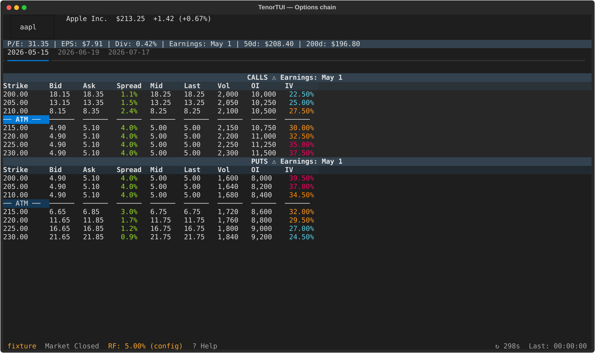
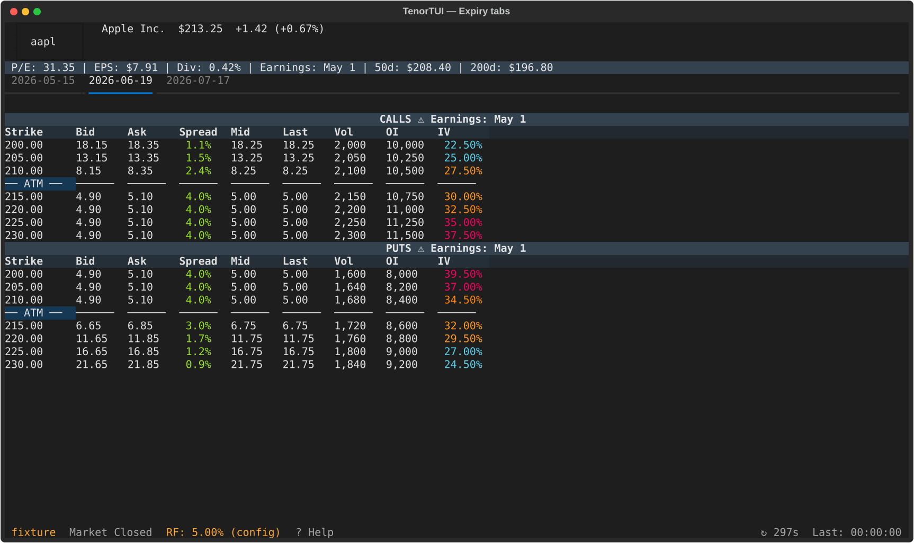
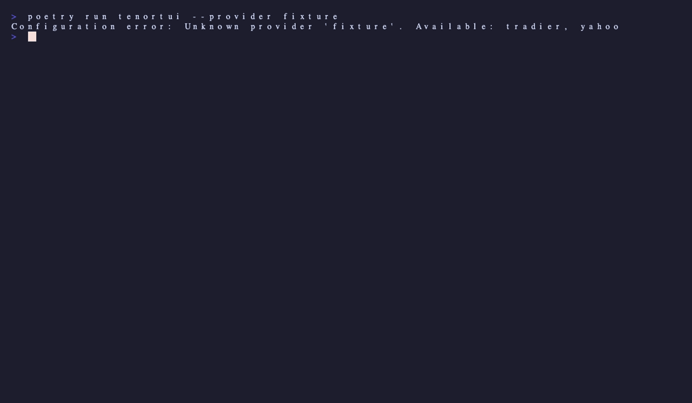

# Options Chain

The options chain is the main view of TenorTUI: calls on the left, puts on the
right, with the at-the-money strike highlighted.

{ loading=lazy }

## Layout

- **Calls table (left):** strike, bid, ask, last, volume, open interest, IV,
  and (if the provider supplies them) Δ Γ Θ ν ρ.
- **Puts table (right):** same columns, mirrored.
- **ATM divider row:** a horizontal divider sits at the strike closest to the
  current underlying price. The view auto-scrolls to keep it centered when you
  load a new chain.

## Expiry tabs

Each expiration date is a tab across the top of the chain. Switch with
<kbd>←</kbd> / <kbd>→</kbd> or click the tab.

{ loading=lazy }

## Greeks columns

Greeks columns appear automatically when the provider supplies them. The
default Yahoo provider does **not** include Greeks; the Tradier provider does.
See [Providers](providers.md) for the full capability matrix.

## Filters

Press <kbd>:</kbd> to open the command palette, then type `filter <expr>`
(or `f <expr>`):

| Command | Shows |
|---|---|
| `filter itm` / `filter otm` | In-the-money / out-of-the-money contracts only |
| `filter volume > N` (or `vol > N`) | Contracts with volume above `N` |
| `filter oi > N` | Contracts with open interest above `N` |
| `filter delta <min> <max>` | Contracts with \|Δ\| in the range, e.g. `delta 0.3 0.7` or `delta .3 .7` |
| `filter clear` | Remove all filters |

An unrecognised or malformed filter (for example `filter delta 1.2.3 0.5`)
shows an "Unknown filter" warning and leaves the current chain unchanged.

## Demo

{ loading=lazy }
